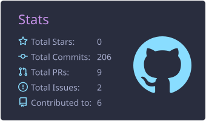
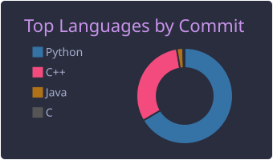
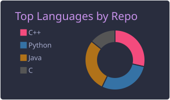
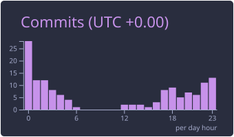
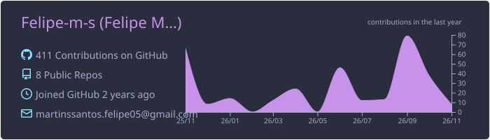

      

      <h2 style="color:FF79C6">🚀 Sobre mim</h2>
    

🎓 Estudante de <strong>Sistemas de Informação</strong> no IFMG - São João Evangelista   
💻 Atualmente aprendendo Python e aprofundando conhecimentos em Algoritmos, Estruturas de Dados e Banco de Dados   
🏡 Apaixonado por <strong>automação residencial</strong> e pelo impacto da tecnologia no dia a dia   
🚀 Interesses: Desenvolvimento Back-End e Projetos de Automação  

  <table align="center">
    <tr>
      <td align="center">
        
      </td>
      <td align="center">
        
      </td>
    </tr>
    <tr>
      <td align="center">
        
      </td>
      <td align="center">
        
      </td>
    </tr>
    <tr>
      <td colspan="2" align="center">
        
      </td>
    </tr>
  </table>

 

## 🛠️ Tecnologias e ferramentas

**Linguagens de programação e desenvolvimento web**

  
  
  
  
  
  
  
  
  

**Frameworks e bibliotecas**

  
  

**Banco de dados**

  
  

**Ferramentas e versionamento**

  
  
  
  
  

**Sistemas operacionais**

  
  

## 📫 Conecte-se comigo

&nbsp;&nbsp;

&nbsp;&nbsp;

